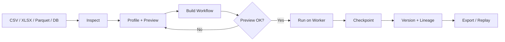
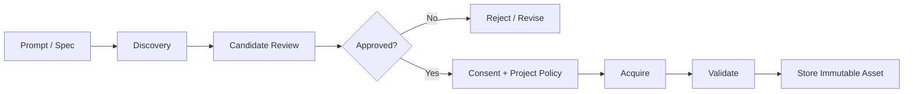
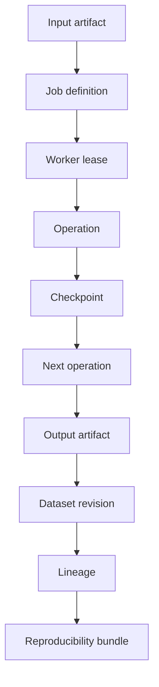
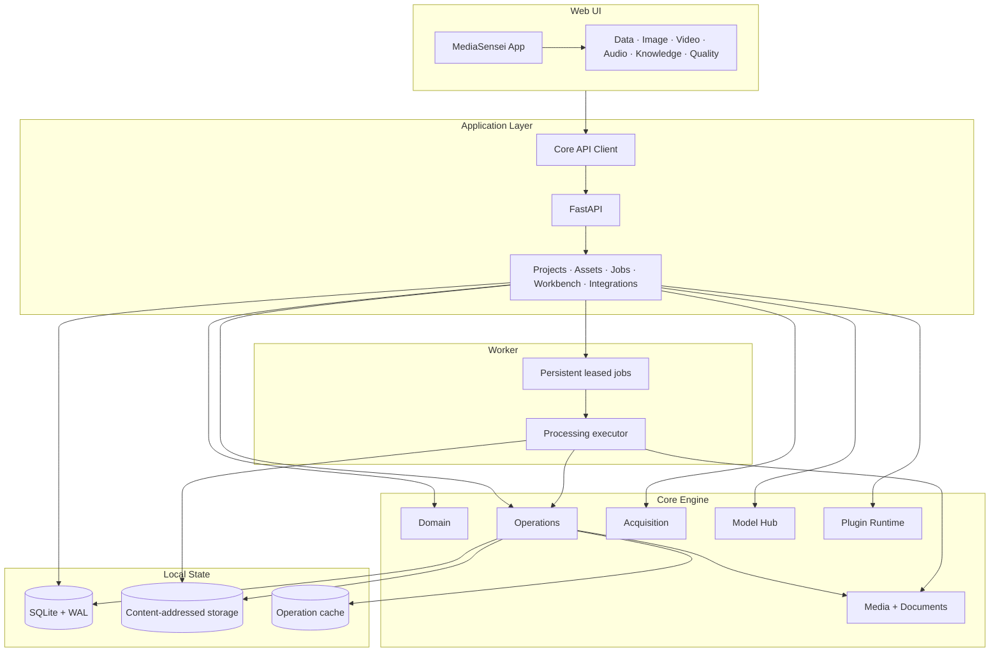
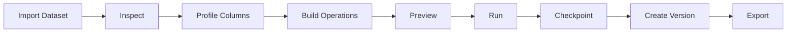

# MediaSensei

<div align="center">

### Local-first multimodal data engineering, dataset preparation & reproducible AI workflows

**Import → Inspect → Transform → Search → Build datasets → Train → Version → Export**

[](https://github.com/Cyanex1702/MediaSensei)
[](LICENSE)


</div>

> [!IMPORTANT]
> **2.0.0-rc.1 is a repaired local release candidate.** The current QA pass validated the Windows release boundary and production frontend build. macOS/Linux native-media certification and authenticated remote-provider flows remain unverified. See [QA_REPORT.md](QA_REPORT.md) and [docs/2.0-status.md](docs/2.0-status.md).

---

## ✦ What is MediaSensei?

**MediaSensei is a local-first workspace for multimodal data engineering.**

It brings files, datasets, media processing, document retrieval, lightweight model training, acquisition, quality checks, and reproducible workflows into one desktop-oriented environment.

Instead of treating processing as disposable scripts, MediaSensei treats work as **persistent, versioned, inspectable jobs and artifacts**.

```text
┌─────────────────────────────────────────────────────────────┐
│                         MediaSensei UI                      │
│ Overview · Library · Jobs · Data · Image · Video · Audio   │
│ Knowledge · Quality · Model Hub · Acquisition · Settings   │
└─────────────────────────────┬───────────────────────────────┘
                              │ REST / JSON
┌─────────────────────────────▼───────────────────────────────┐
│                         FastAPI                             │
│ Projects · Assets · Jobs · Workbench · Integrations         │
└─────────────────────────────┬───────────────────────────────┘
                              │
┌─────────────────────────────▼───────────────────────────────┐
│                         Core                                │
│ Domain · Operations · Media · Documents · Acquisition       │
│ Models · Plugins · Storage · Persistent Job Queue            │
└───────────────┬─────────────────────────────┬───────────────┘
                │                             │
        ┌───────▼────────┐           ┌────────▼─────────┐
        │ SQLite + WAL   │           │ Content-addressed│
        │ Catalog        │           │ storage          │
        └────────────────┘           └────────┬─────────┘
                                             │
                                      ┌──────▼──────┐
                                      │ Local worker │
                                      │ leased jobs  │
                                      └───────────────┘
```

### Design goals

> **Local control + reproducibility + multimodal workflows + explicit state.**

MediaSensei is intentionally scoped as a **trusted, single-user local workstation application**, not a public multi-tenant service.

---

## ✦ Capabilities

| Area                      | What it provides                                                        |
| ------------------------- | ----------------------------------------------------------------------- |
| 🗂️ **Multimodal ingest** | Images, documents, audio/video, tables and ZIP archives                 |
| ⚙️ **Persistent jobs**    | Queue, pause, resume, cancel, retry and inspect job events              |
| 🧪 **Data Lab**           | 35+ executable table operations, previews, profiles, charts and reports |
| 🧬 **Reproducibility**    | Versions, lineage, checkpoints, comparisons and exact replay exports    |
| 🔎 **Knowledge Lab**      | Document parsing, chunking, local indexing, search and RAG bundles      |
| 🖼️ **Image Lab**         | Parameterized transforms, thumbnails, derivatives and OCR               |
| 🎬 **Video / Audio Labs** | FFmpeg-backed media processing with explicit native-tool boundaries     |
| 🧠 **Model Hub**          | Fitted lexical retrieval and supervised language models with revisions  |
| 🌐 **Acquisition**        | Discovery, candidate review, consent and policy-controlled acquisition  |
| 🔌 **Plugin runtime**     | Providers, downloaders, planners, evaluators and analysis plugins       |
| 🔐 **Security**           | OS credential storage, upload/ZIP hardening and loopback-only API       |

---

## ✦ Data Lab

A visual tabular workbench for turning raw data into reproducible datasets.

### Included

* 35+ executable operations
* DuckDB filtering and selection
* Column profiles and statistics
* Explicit preview sampling
* Reusable charts and visual reports
* Train/validation/test splitting
* Training-only preprocessing
* Parameterized workflows and recipes
* Resumable execution with checkpoints
* Immutable versions and comparisons
* Revision-aware concurrency protection
* Lineage-aware restore
* Exact Python / notebook / replay exports



> **Training rule:** create a split before using fitted preprocessing so statistics and category vocabularies are learned exclusively from training rows.

---

## ✦ Media & Knowledge Labs

### Images

* JPG/JPEG
* PNG
* WebP
* BMP
* TIF/TIFF
* GIF
* Parameterized transforms
* JPEG / PNG / WebP outputs
* Thumbnail and derivative generation
* Tesseract OCR
* Windows inbox OCR fallback where available

### Audio / Video

* WAV
* MP3
* FLAC
* M4A
* OGG
* AAC
* MP4
* MOV
* MKV
* WebM
* AVI
* M4V
* FFmpeg + ffprobe integration
* Native-tool availability reporting
* Persistent jobs and retained failures
* Original assets remain untouched

### Knowledge pipeline

```text
Document
   ↓
Parse
   ↓
Normalize
   ↓
Chunk
   ↓
Index
   ↓
Search
   ↓
RAG bundle
```

Supports local document preparation, content units, indexing and retrieval-oriented exports.

Scanned PDFs require an external OCR workflow.

---

## ✦ Model Hub

MediaSensei 2.0 adds lightweight local model lifecycle primitives.

### Features

* Fitted lexical retrieval models
* Supervised language models
* Revisioned model artifacts
* SHA-256 artifact verification
* Training provenance
* Source dataset references
* Archive / reactivate lifecycle
* Local search integration

Model artifacts are validated before use and checksum-verified when loaded.

---

## ✦ Intelligent Acquisition

Acquisition is deliberately separated from downloading bytes.



### Features

* Editable acquisition specifications
* Provider discovery
* Candidate metadata and relevance review
* Consent-aware acquisition
* Target-yield tracking
* Duplicate and quality rejection policies
* Revision-pinned provider requests
* Explicit remote-access policy

Remote acquisition is **never an automatic side effect of local imports**.

See [docs/integrations.md](docs/integrations.md).

---

## ✦ Plugin Runtime

The plugin system provides a versioned extension layer for:

* Discovery providers
* Acquisition downloaders
* Prompt planners
* Relevance evaluators
* Analysis plugins

Plugins use explicit manifests, permissions, versions and SHA-256 source fingerprints.

Trusted analyzers can run through a separate subprocess boundary.

> [!WARNING]
> Python plugin installation, validation and approval can execute plugin code. Only use plugins you trust. The subprocess boundary is an isolation mechanism, **not an OS-level security sandbox**.

See [SECURITY.md](SECURITY.md).

---

## ✦ Jobs, Versions & Reproducibility

A transformation should still be understandable after it finishes.



Run records capture:

* Workflow parameters
* Operation versions
* Library versions
* MediaSensei version
* Input references
* Lineage
* Checkpoints
* Derived artifact references

### Concurrency protection

Dataset updates use revision checks rather than blind overwrites.

A stale workflow cannot silently replace newer dataset state.

### Deterministic caching

Deterministic workflows can reuse cached artifacts using keys derived from:

```text
Input
+
Operations
+
Operation versions
+
Library versions
+
Engine version
+
External inputs
```

---

## ✦ Security & Data Handling

MediaSensei is local-first by design.

### Upload and archive hardening

* Empty-file rejection
* Supported-extension validation
* Corrupt-content diagnostics
* ZIP entry and expansion limits
* Path traversal checks
* Windows drive / alternate-data-stream checks
* Symlink rejection
* Duplicate archive-path detection
* Password-protected ZIP rejection
* Immutable content-addressed originals

Supported saved connections use native OS credential storage instead of storing provider secrets directly in the project database.

The API intentionally binds to loopback and has no user authentication.

> **Do not expose the API directly to the internet.**

See [SECURITY.md](SECURITY.md).

---

## ✦ Architecture



---

## ✦ Repository Structure

```text
MediaSensei/
├── apps/
│   └── api/                 # FastAPI application
│
├── components/              # React UI
├── lib/                     # Frontend/API utilities
│
├── packages/
│   ├── core/                # Domain, jobs, storage, operations, media
│   └── plugin-sdk/          # Plugin contracts
│
├── db/                      # Frontend/local DB bindings
├── drizzle/                 # Frontend database definitions
│
├── docs/
│   ├── architecture/        # Architecture documentation
│   ├── adr/                 # Architecture decisions
│   └── ...                  # Guides, integrations, releases
│
├── scripts/                 # Launchers, smoke tests, release tooling
├── tests/                   # Backend, API and workflow tests
├── public/                  # Static assets
└── qa-evidence/             # Release QA evidence
```

---

## ✦ Visual Product Overview

Add your strongest screenshots here.

```html
<div align="center">


<br><br>


<br><br>


</div>
```

### Recommended README visuals

For the final version, I’d put these near the top:

```text
1. Hero / dashboard screenshot
2. Architecture graph
3. Data Lab screenshot
4. Jobs / pipeline screenshot
5. Knowledge Lab / RAG screenshot
6. Short demo GIF
```

---

## ✦ Quick Start

### Requirements

* **Python 3.12+**
* **Node.js 22.13+**
* Node 24 LTS recommended
* At least **5 GB** free space for setup
* At least **2 GB** free workspace disk during processing
* Internet access for initial dependency installation

### Windows

```bat
start.bat
```

or double-click:

```text
MediaSensei-Windows.bat
```

### macOS / Linux

```sh
sh start.sh
```

On macOS:

```text
MediaSensei-macOS.command
```

can also be used after allowing it to open.

The launcher:

```text
Create virtual environment
        ↓
Install dependencies
        ↓
Initialize configuration
        ↓
Build frontend
        ↓
Start FastAPI
        ↓
Start worker
        ↓
Start frontend
        ↓
Health checks
        ↓
Open MediaSensei
```

The application opens at:

**http://127.0.0.1:3000**

Logs:

```text
.mediasensei-launcher/logs/
```

---

## ✦ Development Mode

### Windows

```bat
start-dev.bat
```

### macOS / Linux

```sh
sh start-dev.sh
```

Stop the application with:

```sh
python3 scripts/mediasensei_launcher.py stop
```

Windows also accepts:

```powershell
python scripts/mediasensei_launcher.py stop
```

---

## ✦ Supported Formats

| Category     | Supported                                                   |
| ------------ | ----------------------------------------------------------- |
| 🖼️ Images   | JPG/JPEG, PNG, WebP, BMP, TIF/TIFF, GIF                     |
| 📄 Documents | TXT, MD, Markdown, PDF, DOCX, HTML/HTM                      |
| 🎵 Audio     | WAV, MP3, FLAC, M4A, OGG, AAC                               |
| 🎬 Video     | MP4, MOV, MKV, WebM, AVI, M4V                               |
| 📊 Tables    | CSV, TSV, JSON, JSONL/NDJSON, Parquet, XLSX, SQLite, DuckDB |
| 📦 Archives  | ZIP                                                         |
| 👁️ OCR      | Tesseract + Windows inbox OCR fallback                      |
| 🤗 Providers | Hugging Face / Kaggle adapters                              |

Audio/video processing requires **FFmpeg and ffprobe** on `PATH`.

Provider integrations are optional.

---

## ✦ Data Limits

| Limit                        |      Default |
| ---------------------------- | -----------: |
| Table page size              |     200 rows |
| Transform row ceiling        | 200,000 rows |
| Parquet processing ceiling   |      256 MiB |
| Maximum upload               |        2 GiB |
| Maximum ZIP entries          |       20,000 |
| Maximum expanded ZIP content |       20 GiB |

These limits are ceilings rather than recommended dataset sizes.

Large datasets may require substantially more memory and temporary disk space.

---

## ✦ Configuration

Copy:

```text
.env.example
```

to:

```text
.env
```

The launcher performs this automatically.

| Variable                              | Default                  | Purpose                                          |
| ------------------------------------- | ------------------------ | ------------------------------------------------ |
| `MEDIASENSEI_WORKSPACE`               | `.mediasensei-workspace` | Metadata, objects, derivatives, jobs and exports |
| `MEDIASENSEI_API_PORT`                | `8000`                   | FastAPI port                                     |
| `MEDIASENSEI_WEB_PORT`                | `3000`                   | Browser port                                     |
| `MEDIASENSEI_STARTUP_TIMEOUT_SECONDS` | `180`                    | Startup readiness allowance                      |
| `NEXT_PUBLIC_CORE_API_URL`            | launcher-derived         | Browser API base                                 |
| `MEDIASENSEI_CORS_ORIGINS`            | `[]`                     | Additional approved browser origins              |
| `MEDIASENSEI_MAX_UPLOAD_BYTES`        | `2147483648`             | 2 GiB upload ceiling                             |
| `MEDIASENSEI_ZIP_MAX_FILES`           | `20000`                  | ZIP entry ceiling                                |
| `MEDIASENSEI_ZIP_MAX_TOTAL_BYTES`     | `21474836480`            | Expanded ZIP content ceiling                     |

### Health

```text
GET http://127.0.0.1:8000/health
```

Also available under:

```text
/api/v1/health
```

### OpenAPI

```text
http://127.0.0.1:8000/docs
```

---

## ✦ Testing

Install development dependencies:

### Windows

```powershell
.venv\Scripts\python -m pip install -e ".[dev,image,data]" -c requirements-lock.txt
```

### macOS / Linux

```sh
.venv/bin/python -m pip install -e '.[dev,image,data]' -c requirements-lock.txt
```

Run:

```sh
npm test
npm run lint
npm run build
npx playwright install chromium
npm run test:e2e
```

Python checks:

```sh
.venv/bin/python -m ruff check apps packages scripts tests
```

The test suite covers:

* Startup
* API contracts
* Real processing flows
* Malformed uploads
* ZIP traversal
* ZIP CRC failures
* ZIP size limits
* Persistence
* Original and derived downloads
* Workflow behavior
* Browser error recovery

FFmpeg integration is skipped when the required binaries are unavailable.

CI is configured for Windows, Linux and macOS.

---

## ✦ 2.0.0-rc.1 Release Evidence

The documented release verification reports:

| Verification                |          Result |
| --------------------------- | --------------: |
| Backend tests               | **186 passing** |
| Client contract checks      |           **8** |
| Production browser checks   |          **41** |
| API / worker restart checks |           **8** |
| Clean wheel checks          |           **6** |
| TypeScript                  |          Passed |
| Lint                        |          Passed |
| Ruff                        |          Passed |
| Production frontend build   |          Passed |
| Source-package verification |          Passed |

These figures describe the documented release evidence.

They do **not** establish:

* Full macOS native-media certification
* Full Linux native-media certification
* Authenticated remote-provider certification
* Multi-user server readiness

See [QA_REPORT.md](QA_REPORT.md), [docs/batch-4.md](docs/batch-4.md), and [docs/2.0-status.md](docs/2.0-status.md).

---

## ✦ Release & Deployment

Create a release verification bundle with:

```sh
npm run release:check
npm run release:bundle
node scripts/run-python.mjs scripts/release.py checksums
```

Release bundles include:

* Source
* Tests
* Configuration examples
* CI configuration
* Launchers

Generated frontend output, dependencies, local environments, logs and user data are excluded.

---

## ✦ Deployment Boundary

MediaSensei is designed for:

> **A trusted, single-user local workstation.**

The API currently:

* Has no user authentication
* Intentionally binds to loopback
* Should not be exposed directly to the public internet

A shared or server deployment would require:

```text
Authentication
+
TLS
+
Reverse proxy
+
Request limits / timeouts
+
Backups
+
Worker supervision
```

See [SECURITY.md](SECURITY.md).

---

## ✦ Data Lab Example



Typical workflow:

1. Import CSV, Excel or Parquet.
2. Inspect rows and columns.
3. Profile columns.
4. Build an operation workflow.
5. Preview a sample.
6. Run the workflow on the worker.
7. Create a named dataset version.
8. Export the dataset or reproducibility bundle.

Snapshots store references rather than copying unchanged data.

Imported source assets are not overwritten.

---

## ✦ Python SDK

MediaSensei exposes a reusable Python workbench.

```python
from mediasensei.operations import Workbench

workbench = Workbench(".mediasensei-workspace")

dataset = workbench.dataset("DATASET_ID")

preview = workbench.preview(
    dataset["id"],
    "fill_missing",
    {
        "columns": ["income"],
        "strategy": "median",
    },
)

job = workbench.enqueue(
    dataset["id"],
    [
        {
            "operation": "fill_missing",
            "parameters": {
                "columns": ["income"],
                "strategy": "median",
            },
        }
    ],
    dataset["revision"],
)
```

The public workbench and worker share the same operation execution implementation.

---

## ✦ CLI

Search available operations:

```sh
mediasensei operation search "heat map"
```

Run an operation:

```sh
mediasensei operation run DATASET_ID profile
```

Generated Python / notebook workflows use the recorded operation and library versions for reproducible replay.

---

## ✦ Core Design Principles

| Principle                       | Meaning                                                      |
| ------------------------------- | ------------------------------------------------------------ |
| **Local first**                 | Data and processing stay on the user's machine by default    |
| **Immutable inputs**            | Imported source bytes are never silently replaced            |
| **Explicit state**              | Jobs, revisions, checkpoints and failures remain inspectable |
| **Reproducible work**           | Export workflows, versions and lineage—not only final files  |
| **Policy before remote access** | External acquisition requires explicit project permission    |
| **Extensible by contract**      | Plugins use versioned interfaces and explicit trust          |

---

## ✦ Current Boundaries

The current architecture is optimized for the local MVP / release-candidate boundary.

Areas still evolving include:

* Larger-scale multi-user processing
* More extensive catalog pagination
* Further decomposition of large UI/API modules
* Broader native-media certification
* Authenticated remote-provider certification
* Stronger OS-level plugin sandboxing

See the current release documentation before treating unreleased functionality as production-complete.

---

## ✦ Documentation

| Topic                         | Link                                               |
| ----------------------------- | -------------------------------------------------- |
| Release status                | [docs/2.0-status.md](docs/2.0-status.md)           |
| Batch 1 verification          | [docs/batch-1.md](docs/batch-1.md)                 |
| Batch 4 certification         | [docs/batch-4.md](docs/batch-4.md)                 |
| Integrations                  | [docs/integrations.md](docs/integrations.md)       |
| Data Workbench                | [docs/media-workbench.md](docs/media-workbench.md) |
| Architecture                  | [docs/architecture/](docs/architecture/)           |
| Architecture decision records | [docs/adr/](docs/adr/)                             |
| QA Report                     | [QA_REPORT.md](QA_REPORT.md)                       |
| Security                      | [SECURITY.md](SECURITY.md)                         |
| Engineering report            | [docs/audit-1.0.2.md](docs/audit-1.0.2.md)         |

---

## ✦ Why MediaSensei?

MediaSensei is built around a simple idea:

> **Data preparation should be reproducible infrastructure, not a pile of disconnected scripts.**

The platform connects:

```text
Raw Files
   ↓
Persistent Ingestion
   ↓
Multimodal Processing
   ↓
Structured Datasets
   ↓
Retrieval / RAG
   ↓
Model Preparation
   ↓
Versioned Workflows
   ↓
Reproducible Exports
```

That makes MediaSensei useful as a bridge between:

**data engineering → multimodal processing → retrieval → AI/ML experimentation**

---

## License

MediaSensei is released under the **Apache License 2.0**.

See [LICENSE](LICENSE).

<div align="center">

### MediaSensei

**Local-first multimodal data engineering**

Built around **reproducibility · inspectable state · practical AI workflows**

</div>
