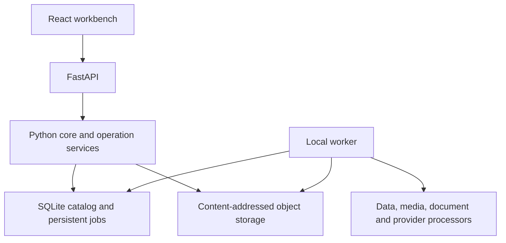

<div align="center">

# MediaSensei

### Local-first multimodal data engineering, dataset preparation & reproducible workflows

**Import → Inspect → Transform → Validate → Version → Export**

[](#whats-new-in-200-rc2)
[](LICENSE)
[](#quick-start)
[](#quick-start)
[](#security--data-handling)


[Overview](#what-is-mediasensei) · [Capabilities](#capabilities) · [Quick start](#quick-start) · [Release changes](#whats-new-in-200-rc2) · [Example dataset](#companion-dataset-messy-retail-data) · [Documentation](#documentation)

</div>

---

## What is MediaSensei?

**MediaSensei is a local workspace for turning raw files into inspectable, reusable datasets.**

It brings tabular preparation, media processing, document retrieval, data acquisition, quality checks, lightweight local models, and reproducible workflows into one interface. Work is organized into projects, with a Library for source assets, dedicated labs for processing, and persistent jobs for execution.

A file import is the beginning of a workflow. You can inspect its structure, preview changes, run transformations, review failures, save a version, and export the result with its history. Original source bytes remain preserved in content-addressed storage.

MediaSensei is useful for:

- **Data scientists** preparing and validating datasets before analysis or modeling.
- **Researchers and students** exploring local tables, documents, images, audio, or video.
- **Dataset builders** collecting and reviewing source material with provenance.
- **Developers** reusing operations through the API, CLI, Python core, or plugin SDK.

It is designed for a **trusted, single-user workstation**. Processing stays local by default; remote acquisition and provider imports require explicit authorization.

## Capabilities

| Area | What it provides |
|---|---|
| **Multimodal ingestion** | Import tables, documents, images, audio/video, and supported files inside ZIP archives. |
| **Data Lab** | Profiles, cleaning, type conversion, filtering, reshaping, combining, charting, splits, and preprocessing. |
| **Quality** | Persistent validation rules, column dictionaries, revision-aware reports, and examples of offending rows. |
| **Library** | Source browsing, metadata inspection, selections, state controls, and saved search/modality collections. |
| **Image Lab** | Transform previews, image conversion, resizing, thumbnails, derivatives, and supported OCR. |
| **Video / Audio Labs** | FFmpeg-backed inspection and media operations with persistent job state. |
| **Knowledge Lab** | Document parsing, chunking, local indexing, retrieval, and RAG-oriented exports. |
| **Model Hub** | Fitted lexical retrieval and supervised language-classification models with revisioned artifacts. |
| **Sources** | Image discovery, acquisition plans, filters, candidate review, consent, and target tracking. |
| **Workflows & Versions** | Reusable recipes, recorded parameters, checkpoints, version comparisons, restore, and replay exports. |
| **Storage & Recovery** | Immutable objects, storage inspection, portable backups, and verified restore into a new folder. |
| **Extensions** | Versioned plugin contracts and explicit trust for executable plugins. |

## What's new in 2.0.0-rc.2?

This release strengthens import correctness, acquisition decisions, and day-to-day dataset preparation.

| Change | What it means in practice |
|---|---|
| **Explicit CSV/TSV validation** | Inconsistent records, invalid headers, and parsing problems fail with useful diagnostics instead of silently becoming an incorrect table. |
| **Delimiter and text controls** | Choose supported delimiters and keep identifiers such as `00123` as text. Import options reach the worker and remain in provenance. |
| **Database/workbook source selection** | Choose the table or sheet you want from the normal upload workflow. |
| **Corrected acquisition relevance** | The originating search query no longer counts as evidence that an individual candidate is relevant. |
| **Enforced supported license constraints** | Supported CC-only instructions populate the plan's filters. Provider license labels are normalized without treating CC-BY-NC or CC-BY-SA as CC-BY. |
| **Clear unsupported-request handling** | Requests outside image discovery's scope, or unsupported free-text constraints, are rejected explicitly. |
| **Saved quality contracts** | Store required, unique, numeric, range, and allowed-category checks, plus a column dictionary. |
| **Reusable Library collections** | Save filename/hash search and modality filters for later use. |
| **Backup and restore tools** | Snapshot committed SQLite state and stored files; verify checksums and restore without overwriting the existing workspace. |
| **Better resource feedback** | See when processing is paused for low memory or disk space, with guidance to recover. |
| **Windows setup improvements** | Check prerequisites, install dependencies, attempt native-tool setup, build, and start the app through one launcher. |
| **Dependency maintenance** | Update frontend dependencies and retain required third-party notices. |

### Verification

The Windows release checks included **210 passing backend tests with no skips**, **15 client tests**, and **44 production browser scenario checks** with no page errors. TypeScript, lint, dependency checks, and the frontend build passed. The dependency audit reported zero known advisories at the time of verification.

A fresh extraction in a folder containing spaces also installed its own application dependencies, built, launched, and passed a browser smoke workflow. Python and Node were already present for that check. These results describe the tested environment; they do not certify every operating system, provider account, or workload.

## Data Lab

A visual workbench for turning imported tables into reproducible working datasets.

### Explore and prepare

- Inspect column types, missing values, frequencies, statistics, and samples.
- Search, filter, sort, and select table rows and columns.
- Clean missing values, duplicates, strings, dates, and categories.
- Convert types, derive columns, reshape data, and combine datasets.
- Create charts and export visual reports.
- Build reusable operation workflows and parameterized recipes.

### Prepare for modeling

Create train/validation/test splits and use the supported fitted preprocessing operations. Keep fit-dependent statistics and vocabularies restricted to the training partition.

> **Split before fitting preprocessing.** Validation/test information should not influence training statistics. A successful small preview is also not proof that the full dataset is free of defects.

### Preserve and reproduce

Working revisions, named versions, comparisons, lineage, and workflow records help explain how an output was produced. Export a working table or a reproducibility bundle with source references and recorded operations.

```text
CSV / Excel / Parquet / Database
              ↓
       Inspect + profile
              ↓
       Preview operations
              ↓
         Run on worker
              ↓
      Validate + save version
              ↓
       Export + reproduce
```

## Quality & Data Dictionaries

Save a set of checks against a working dataset and run it on the current revision.

| Check | Example |
|---|---|
| Required | Every row must have a customer identifier. |
| Unique | An order identifier should not repeat. |
| Numeric | A quantity must be interpretable as a number. |
| Minimum / maximum | A quantity must fall within the chosen range. |
| Allowed categories | A channel must belong to the approved set. |

Reports record the dataset revision, content reference, rule results, total failure counts, and up to **100 example offending rows**. Download the report for review. These checks do not modify rows and must be rerun after changes; they are not automatic workflow gates.

Use the column dictionary for meanings, units, source notes, and intended roles. Keep necessary context with the dataset rather than in a separate conversation.

## Media & Knowledge Labs

### Images

Import supported images, inspect metadata, preview edits, and create derived outputs. Image workflows include resizing, conversion, thumbnails, and parameterized transformations. OCR uses supported Tesseract or Windows inbox capabilities where available.

### Audio and video

Run supported FFmpeg/ffprobe-backed inspection, conversion, trimming, and derivative operations. Jobs retain their progress and failures, and source assets remain unchanged.

Native-tool availability is reported by the app. The Windows launcher attempts media-tool installation; other platforms need their own native tools available.

### Documents and retrieval

```text
Document → Parse → Chunk → Index → Search → Retrieval bundle
```

Knowledge Lab prepares supported documents for local search and retrieval-oriented exports. Model Hub provides fitted lexical retrieval and language-classification models, with checksummed revisions and recorded sources.

The built-in lexical models are not general neural semantic models or a full model-training platform. Scanned PDFs require an OCR preparation workflow.

## Intelligent Acquisition

Sources separates a collection plan from the act of downloading files.

1. Describe an image collection or edit a plan.
2. Inspect the target, providers, filters, relevance strategy, and budgets.
3. Enable the project's remote-access policy and explicitly authorize the run.
4. Review discovered candidates and retained previews.
5. Follow accepted/rejected/review counts and the final result or shortfall.

Supported discovery paths include Wikimedia Commons, Openverse, and direct image URLs. Quality, duplicate, domain, and supported license policies can affect acceptance. Metadata relevance uses candidate title/description; it does not verify visual content.

**Discovery is image-first.** Use Connections for supported provider dataset imports. A CSV or document request is not silently converted into image acquisition. Provider credentials, access restrictions, network conditions, and rate limits still apply.

Remote access is never an automatic side effect of importing a local file.

## Jobs, Versions & Reproducibility

Longer operations run through the persistent worker rather than depending on an open browser tab.

Job and workflow records retain input references, parameters, operation versions, progress, checkpoints, failures, and derived artifacts. Supported controls let you pause, resume, cancel, retry, and inspect work.

Dataset revisions protect against stale writes. Named versions and comparisons let you inspect changes and return to a saved state. Eligible deterministic operations can reuse cached artifacts based on their recorded inputs and execution context.

Exports are designed to preserve more than final bytes: retain the dataset version, workflow, and provenance needed to understand the result.

## Companion Dataset: Messy Retail Data

**Messy Retail Data: Raw vs Clean Challenge** is a synthetic dataset created to demonstrate a practical MediaSensei workflow.

It includes linked customer, product, and order tables, deliberately messy raw files, pre-corruption clean references, a SQLite database, a data dictionary, an issue ledger, a reproducible generator, and a starter notebook.

| Table | Raw records | Clean reference records |
|---|---:|---:|
| Orders | 25,500 | 25,000 |
| Customers | 4,050 | 4,000 |
| Products | 155 | 150 |

The fictional orders cover **2024–2025**. Planted issues include missing values, exact duplicates, damaged ID padding, inconsistent categories, mixed dates, invalid quantities/prices, broken references, and incorrect totals. Some unusual orders are legitimate, so not every outlier should be deleted.

### What was done in MediaSensei

The companion data was generated with its supplied Python script, then exercised through the actual app:

1. Imported **25,500 raw order rows** while preserving leading-zero identifiers.
2. Created a working dataset and saved a version before transformation.
3. Removed **500 exact duplicate orders**, leaving **25,000 rows**.
4. Saved quantity checks and identified **680 remaining rows** with missing or out-of-range quantities.
5. Downloaded the working Parquet file and verified it against an independent deduplication result.
6. Imported the database's `clean_orders` table through the source selector and verified **25,000 rows**.
7. Reloaded the app and checked that the revision persisted.

Deduplication was a partial cleaning demonstration. The exported table still contained other planted defects. The clean reference was generated before corruption; it was not automatically reconstructed by the app.

### Kaggle

**Publication pending — placeholder link:** [Messy Retail Data on Kaggle](https://www.kaggle.com/datasets/YOUR_USERNAME/messy-retail-data-raw-vs-clean-challenge)

Replace that URL after publishing. It is a placeholder, not a live dataset page.

All records are synthetic. There are no real customers, transactions, stores, brands, or personal information. The dataset is intended for cleaning, validation, SQL, and exploratory-analysis practice—not claims about actual markets or fraud. Its own license and documentation are separate from the app's license.

## Architecture



| Path | Purpose |
|---|---|
| `app/` | Web entry points, metadata, and styling. |
| `components/` | Workbench screens and reusable interface components. |
| `apps/api/` | FastAPI routes and service adapters. |
| `packages/core/` | Operations, jobs, storage, media, documents, and acquisition. |
| `packages/plugin-sdk/` | Versioned extension contracts. |
| `lib/` | Frontend API clients and utilities. |
| `scripts/` | Setup, launch, verification, and packaging tools. |
| `tests/` | Backend, API, and workflow regression tests. |
| `docs/` | User and integration documentation. |

## Quick Start

### Requirements

- Python **3.12+**.
- Node.js **22.13+**; Node 24 is used in the configured CI workflow.
- Internet access for initial dependency installation.
- At least **5 GiB free space** for first Windows setup.
- Available memory and processing headroom; the worker pauses below **2 GiB free disk** or **512 MiB available memory**.

### Windows: one-click startup

Extract the project into a permanent, writable folder and double-click:

```text
MediaSensei-Windows.bat
```

`start.bat` also starts the Windows launcher. With Windows App Installer (`winget`) available, setup checks prerequisites, installs missing runtimes when needed, attempts native media-tool setup, prepares the private environment, and builds the frontend. Installers may request system permission.

```text
Check requirements → Install dependencies → Build
                   → Start API + worker + web
                   → Check readiness → Open browser
```

Open **[http://127.0.0.1:3000](http://127.0.0.1:3000)** if the browser does not open automatically. API health is available at **[http://127.0.0.1:8000/health](http://127.0.0.1:8000/health)**, and the local API reference at **[http://127.0.0.1:8000/docs](http://127.0.0.1:8000/docs)**.

| Action | Launcher |
|---|---|
| Start | `MediaSensei-Windows.bat` |
| Stop services | `Stop-MediaSensei-Windows.bat` |
| Back up | `Backup-MediaSensei.bat` |
| Restore into a new folder | `Restore-MediaSensei.bat` |

Logs are stored in `.mediasensei-launcher/logs/`. If native-tool installation fails, table workflows can still run; the affected media operations need their tools installed before use.

### macOS and Linux

Install Python and Node.js, then run:

```sh
sh start.sh
```

The macOS launcher `MediaSensei-macOS.command` is also included. Native media, OCR, credential storage, and speech capabilities depend on the platform and installed tools. Windows-specific adapters do not provide identical functionality on every OS.

## Supported Formats

| Category | Formats / requirements |
|---|---|
| Images | JPG/JPEG, PNG, WebP, BMP, TIF/TIFF, GIF. |
| Documents | TXT, Markdown, PDF, DOCX, HTML/HTM. |
| Tables | CSV, TSV, JSON, JSONL/NDJSON, Parquet, XLSX, SQLite, DuckDB. |
| Audio | WAV, MP3, FLAC, M4A, OGG, AAC; supported processing requires FFmpeg/ffprobe. |
| Video | MP4, MOV, MKV, WebM, AVI, M4V; supported processing requires FFmpeg/ffprobe. |
| Archives | ZIP, subject to supported content and archive limits. |
| OCR | Tesseract and supported Windows inbox fallback. |
| Provider imports | Optional Hugging Face / Kaggle adapters, with their access requirements. |

## Configuration & Working Limits

The launcher creates `.env` from `.env.example`. Environment variables override file settings. Keep the real `.env` private.

| Variable | Default | Purpose |
|---|---|---|
| `MEDIASENSEI_WORKSPACE` | `.mediasensei-workspace` | Catalog, objects, jobs, and generated data. |
| `MEDIASENSEI_API_PORT` | `8000` | Local API port. |
| `MEDIASENSEI_WEB_PORT` | `3000` | Browser interface port. |
| `MEDIASENSEI_STARTUP_TIMEOUT_SECONDS` | `180` | Readiness allowance. |
| `NEXT_PUBLIC_CORE_API_URL` | Launcher-derived | Browser API origin; origin changes require a rebuild. |
| `MEDIASENSEI_CORS_ORIGINS` | `[]` | Additional approved browser origins. |
| `MEDIASENSEI_MAX_UPLOAD_BYTES` | `2147483648` | General upload ceiling. |
| `MEDIASENSEI_ZIP_MAX_FILES` | `20000` | Archive entry ceiling. |
| `MEDIASENSEI_ZIP_MAX_TOTAL_BYTES` | `21474836480` | Expanded ZIP content ceiling. |

Optional overrides are available for `MEDIASENSEI_FFMPEG`, `MEDIASENSEI_FFPROBE`, and `MEDIASENSEI_TESSERACT`.

**Tabular inspection and transformations are bounded to 200,000 rows, 256 MiB source files, and a 1 GiB decoded-data allowance.** The general upload ceiling does not make every format processable at that size. Split or query larger sources into bounded extracts before import.

## Backup, Restore & Storage

Backups preserve committed SQLite state and stored content, with checksums for verification. The Windows restore tool writes a new workspace directory and can activate it without deleting the old workspace. Native OS credentials are not included; re-save provider connections when their workspace location changes.

System provides storage usage and project-manifest downloads. A manifest is an inventory, not a backup of dataset bytes. Stored objects can be shared by originals, versions, outputs, and caches—do not delete them manually.

## Security & Data Handling

- Local processing and remote acquisition have separate permissions.
- Supported saved secrets use the native OS credential store.
- Uploads and archives are checked for supported formats, empty content, unsafe paths, corruption, and configured limits.
- Original file objects are retained rather than silently overwritten.
- Plugin trust is explicit and tied to source fingerprints.

Python plugins are executable code. Review them before granting trust; a subprocess boundary is not a complete operating-system sandbox.

The API binds to loopback and has no multi-user authentication boundary. **Do not expose the API or frontend directly to untrusted networks.** Exports, retrieval bundles, fitted vocabularies, and backups can contain source information; handle them according to the privacy of the underlying data.

See [SECURITY.md](SECURITY.md) for reporting and security boundaries.

## Development & Testing

Use `start-dev.bat` on Windows or `sh start-dev.sh` on macOS/Linux for development startup.

Install development extras using the private environment's Python:

```sh
python -m pip install -e ".[dev,image,data]" -c requirements-lock.txt
npm ci
```

Run the standard checks:

```sh
npm run lint
npm test
npm run build
python -m ruff check apps packages scripts tests
```

For browser coverage:

```sh
npx playwright install chromium
npm run test:e2e
```

Native-media coverage depends on available tools. CI is configured for Windows, Linux, and macOS; a configured job is not a guarantee that every native adapter works on each platform.

### Python workbench example

```python
from mediasensei.operations import Workbench

workbench = Workbench(".mediasensei-workspace")
dataset = workbench.dataset("DATASET_ID")

preview = workbench.preview(
    dataset["id"],
    "fill_missing",
    {"columns": ["income"], "strategy": "median"},
)

job = workbench.enqueue(
    dataset["id"],
    [{
        "operation": "fill_missing",
        "parameters": {"columns": ["income"], "strategy": "median"},
    }],
    dataset["revision"],
)
```

Use this against an existing compatible working dataset and an appropriate split. The core operation implementation is shared by the API and worker.

## Documentation

| Topic | Guide |
|---|---|
| Setup, imports, recovery | [Getting started](GETTING_STARTED.md) |
| Data and media workflows | [Media workbench](docs/media-workbench.md) |
| Models, connections, Playground, voices | [Integrations](docs/integrations.md) |
| API and CLI | [Interfaces](docs/interfaces.md) |
| Extension development | [Plugins](docs/plugins.md) |
| Contribution process | [Contributing](CONTRIBUTING.md) |
| Security boundaries | [Security](SECURITY.md) |

## License

**Copyright © 2026 Cyanex.**

MediaSensei is source-available under the **[MediaSensei Community Non-Commercial License v1.0](LICENSE)**.

Personal, educational, academic, research, evaluation, hobby, and other **non-commercial** use is permitted subject to that license. Commercial use—including qualifying internal use by a for-profit business, paid services, commercial redistribution, and hosted/SaaS offerings—requires prior written authorization or a separate commercial license from Cyanex.

Contributions are subject to Section 7. Third-party components retain their own licenses; the MediaSensei license applies only to material Cyanex is authorized to license. The companion dataset has its own licensing terms.

**Commercial licensing:** [maliksaad277@email.com](mailto:maliksaad277@email.com) · [Cyanex on GitHub](https://github.com/Cyanex1702)

---

<div align="center">

**MediaSensei** · Local control · Inspectable state · Reproducible datasets

</div>
